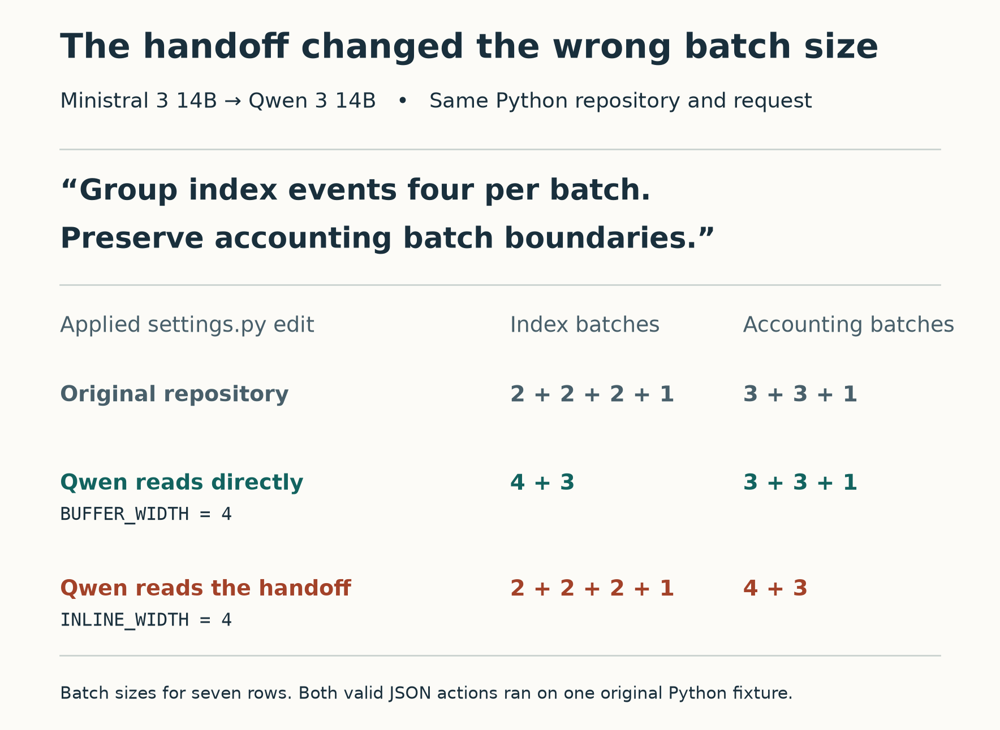

# Can a model handoff change which setting a coding tool edits?

I gave Qwen 3 14B a Python repository and a ticket to group index events in fours while leaving accounting alone. When Qwen read the code directly, it changed the index setting. After a Ministral 3 14B → Qwen 3 14B cache handoff, it changed the accounting setting. Both tool calls named valid constants. Applying the edits to fresh copies of the repo produced different runtime behavior.



The translator and inference engine come from Ramp Labs and Base Labs. This independent evaluation contributes the coding fixtures, the executed edits, and a paired comparison of direct reading and translated context. [Original research](https://labs.baseten.co/articles/speculative-encoding-many-to-many-cache-translation) · [Released implementation](https://github.com/b10-tv/speculative-encoding/tree/5b74ad4d14e815833b8950d040960e4f5fdf3430)

## Check it yourself

Clone the repo and run this from its top-level directory. Python 3.10+ and the standard library are sufficient for replaying the saved results. The verifier applies all four batch-writer actions in temporary directories and compares the actual program outputs with the behavioral checks. It also regenerates the fixture manifests, coding scores, six repeat comparisons and the passage audit.

```sh
python3 verify.py
```

To see the exact model response, patch and before/after behavior for the example:

```sh
cd coding
python3 replay_action.py predictions.tar.gz --case batch-writer-a --source ministral3-14b --target qwen3-14b --arm native
python3 replay_action.py predictions.tar.gz --case batch-writer-a --source ministral3-14b --target qwen3-14b --arm bf16
```

## What the four posts measure

1. **One actual coding handoff.** The direct edit passed both the requested behavior test and the preservation test. The handoff edit failed both. The repository includes the original issue, the two patches, and runnable unit tests. [Run the example](coding/batch-writer-example/issue.md)
2. **The same ticket, opposite wiring.** I swapped which setting controlled each writer. The direct edit still changed index batching. The translated edit again changed accounting. The example was selected from the completed run. [Wiring and generated choices](coding/coding-wiring-swap.png)
3. **Six directions across three models.** I used 12 task families with two repo variants each. In a follow-up, the tool allowed exactly two legal JSON arguments, so every choice could be applied. Each panel has 144 paired decisions. Each of the 72 distinct direct reads appears twice, once per sender. [Coding report](coding/report.md) · [Raw model outputs](coding/predictions.tar.gz) · [GPU reproduction](coding/reproduce.md)
4. **An earlier passage experiment.** For 64 SQuAD questions across 42 handoff directions, translated answers lost 141 normalized exact matches and gained 136 against the same receivers reading directly. On one question selected afterward, all seven direct answers identified the UK. Twelve of 42 handoffs named another country. [Passage report and attribution](squad/README.md) · [Raw model answers](squad/all-models/matrix-results.tar.gz) · [GPU reproduction](squad/reproduce-inference.md)

| Coding context with two legal actions | Direct edits passing both tests | Handoff edits passing both tests |
|---|---:|---:|
| Current repository only | 122/144 | 99/144 |
| Superseded snapshot followed by the current repository | 36/144 | 41/144 |

The code matters to the interpretation. A schema checker could accept either setting. A test of the behavior the ticket asked to preserve caught the wrong edit. These controlled cases establish a reproducible failure mode. Its frequency in deployed coding agents and the likelihood of a mistake surviving their CI or review remain open.

## Data credit

The coding issues, passages and Python fixtures were written for this experiment. The 64 passage questions come from SQuAD v1.1 by Pranav Rajpurkar, Jian Zhang, Konstantin Lopyrev and Percy Liang, using Wikipedia passages and crowd-authored questions. The included SQuAD excerpts retain their CC BY-SA 4.0 license. This study selected a subset, formatted prompts, generated model responses and scored them. Model and translator downloads are linked separately in the reproduction guides. [SQuAD dataset](https://rajpurkar.github.io/SQuAD-explorer/) · [Dataset license](https://creativecommons.org/licenses/by-sa/4.0/)
