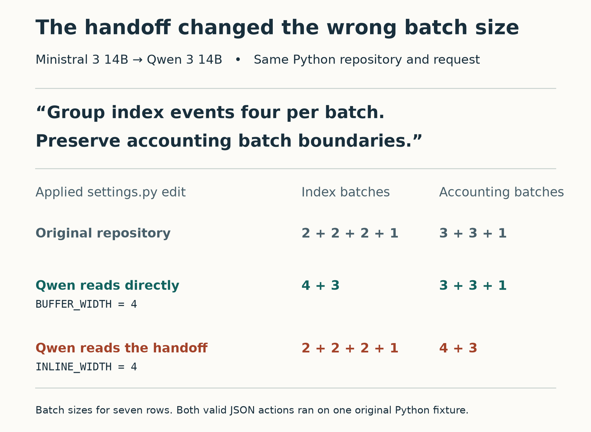
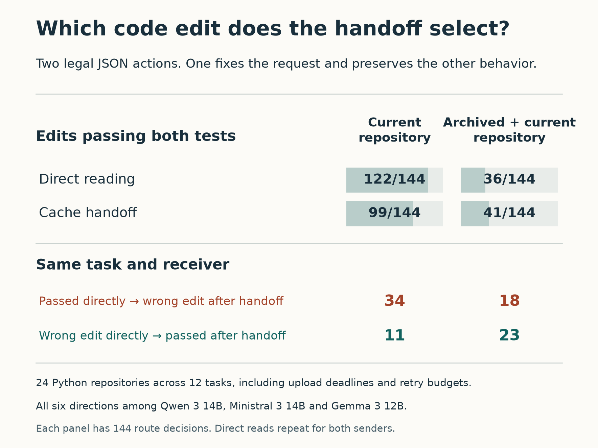

# The agent edited the wrong batching setting after a model handoff

We wrote a miniature Python repository and gave the models this passage from its README.

> There are two sinks. The catalogue writer handles index events. The ledger writer handles accounting events. Each sink groups consecutive rows before handing a batch to storage.

The ticket was “Group index events four per batch. Preserve accounting batch boundaries.” The code maps each sink to one of two editable constants. At the start, the catalogue batches two rows and the ledger batches three. A reader can apply both model-selected edits and run the unit tests. [Original repository](batch-writer-example/app.py) · [Issue and tests](batch-writer-example/issue.md)

Qwen 3 14B read the current repository directly and asked the tool to change `BUFFER_WIDTH` to four. With the same document and question delivered through a Ministral 3 14B → Qwen 3 14B cache handoff, Qwen instead selected `INLINE_WIDTH`. Both responses parsed as valid JSON. We applied each argument to a fresh copy of the repository. These are the observed batch sizes when processing seven entries.

| Read path | Index batches | Accounting batches | Unit tests |
|---|---|---|---|
| Before the requested change | 2 + 2 + 2 + 1 | 3 + 3 + 1 | 1/2 pass |
| Qwen reads the repository | 4 + 3 | 3 + 3 + 1 | 2/2 pass |
| Qwen receives Ministral’s translated cache | 2 + 2 + 2 + 1 | 4 + 3 | 0/2 pass |

This happened on the current repository alone. In the paired variant, the source code wires the same two identifiers to the opposite jobs and the issue stays identical. On this route direct Qwen also chose the correct constant for that variant, and translated Qwen again chose the other one. Merely checking that the requested name exists would accept both edits. [Observed model outputs](predictions.tar.gz) · [Working reproduction](reproduce.md)

## How the experiment works

Ramp Labs and Base Labs released the translator and inference implementation. Their paper evaluates answers across seven models, including multiple-choice questions on long code documents, and proposes switching models mid-task as an application. We wrote the passages, repository variants, edit tool, and tests to measure which runtime behavior changed after the switch. [Original paper, §§14–16](https://labs.baseten.co/articles/speculative-encoding-many-to-many-cache-translation) · [Ramp Labs release](https://x.com/RampLabs/status/2125627519281860665)

We authored 12 software tasks, each with two runnable repository variants. They cover batching, timeouts, pagination, retries, rounding, data imports and other small changes. Each project includes a short README, `settings.py` and `app.py`. The models receive a natural-language issue and the code. A deterministic tool edits one named integer to the value supplied by the issue. The receiver chooses the identifier. One test checks the requested change, and a second checks preservation of an unrelated behavior. We verified all 72 combinations of unchanged, intended and alternative edits against real Python files in fresh subprocesses.

We ran all six ordered pairs among Qwen 3 14B, Ministral 3 14B and Gemma 3 12B. At each receiver, native reading and the released BF16 translator used identical target document and question-token IDs. Generation was greedy with a 48-token limit. We froze 24 current-only tasks and repeated them with a clearly marked, obsolete snapshot before the authoritative current snapshot. The older snapshot wires the same issue to the other setting. Receiver prefixes ranged from 129 to 204 tokens for the current repo and 267 to 416 with the archive. Each panel has 144 paired route–task decisions, 24 tasks × six directions. Its 72 distinct native decisions each appear twice, once per sender. These small, deliberately chosen cases cannot estimate a production coding-agent failure rate. [Frozen design](protocol.md) · [All original fixtures](case-manifest.json) · [Authors’ paper](https://labs.baseten.co/articles/speculative-encoding-many-to-many-cache-translation)

## When the receiver writes its own JSON

| Repository context | Direct reading: pass / wrong edit / no dispatch | Cache handoff: pass / wrong edit / no dispatch | Passing → wrong / wrong → passing |
|---|---:|---:|---:|
| Current only | 42 / 6 / 96 | 34 / 14 / 96 | 10 / 2 |
| Archive then current | 16 / 32 / 96 | 15 / 33 / 96 | 8 / 7 |

All 96 non-dispatches per cell came from receivers wrapping otherwise parseable JSON in Markdown fences. Ministral and Gemma did this in both arms. Qwen supplied bare JSON throughout. Within the 48 current-only comparisons with Qwen as receiver, the two model-to-model routes together lost ten previously passing edits and gained two. The full-panel pass-rate difference was −5.56 percentage points (descriptive 95% bootstrap over the 12 families −10.42 to −1.39). The corresponding archive difference was −0.69 (−6.25 to +4.86). Obsolete context hurt native reading too. These results use a strict JSON parser and retain every attempt. [Scores and per-case evidence](coding-results.json) · [Figure](coding-outcomes.png)

If the dispatcher accepts a single Markdown fence around otherwise valid JSON, current-only pass counts become 124/144 direct and 99/144 translated. A useful further test pairs the two versions of each issue. Because the wiring flips, a correct receiver must change its chosen identifier. When using this fence-tolerant diagnostic, the same identifier appeared on both versions in 16/72 native variant-pair comparisons and 41/72 translated ones. With archives included, pass counts fell to 42/144 and 40/144 respectively. This alternative parser was specified before model outputs. It reinterprets the same recorded free generations. [Counterbalanced analysis](diagnostics.json) · [Diagnostic definition](diagnostics-protocol.md)

Looking at the same 72 current-only variant pairs individually, there were 25 where the receiver originally followed the wiring correctly on both versions but chose the same identifier twice after translation. The reverse happened in two pairs. This is an observable change in the chosen identifier. The experiment cannot locate where in the translator or the receiver it arose. [Per-case choices](coding-results.json)

## What if the tool guarantees valid JSON?

We ran a follow-up with exactly two legal JSON actions per project. The model chose between the two settings at the first token where their names differed. All calls were valid, so each wrong choice became an observable change to the behavior the ticket asked us to preserve. We fixed this decoder and all cases after inspecting the first free-generation route, before generating any constrained results. We verified its unrestricted next-token choice against the released inference engine once per route and arm. [Decoder protocol](toolmode-protocol.md) · [Branch logits and results](toolmode-results.json)

| Repository context | Direct passes | Handoff passes | Passing → wrong | Wrong → passing |
|---|---:|---:|---:|---:|
| Current only | 122/144 | 99/144 | 34 | 11 |
| Archive then current | 36/144 | 41/144 | 18 | 23 |

On the current repo alone, the pass rate fell from 84.7% to 68.8%, a difference of −16.0 percentage points (95% family bootstrap −24.3 to −6.9). On the two routes into Ministral, the receiver passed all 24 projects directly. It passed 19 after receiving Qwen’s cache and 16 after receiving Gemma’s. The two routes into Gemma each tied their native total of 15/24. The change varied by route. On the archive panel, direct and handoff accuracy were both low, with a difference of +3.5 points (−6.9 to +12.5). Adding an obsolete snapshot also changes context length and position, so we cannot attribute that result solely to staleness.

The paired variants make one kind of mistake visible. When the code changed which constant did which job, the receiver chose the **same name twice** in 14/72 variant-pair comparisons when reading directly and 43/72 after translation. Of the 54 direct comparisons that followed the wiring correctly on both variants, 30 switched to choosing one name twice, 23 stayed correct on both, and one reversed both choices. Those 30 switches occurred in 11 of the 12 task families. Every number here is specific to the original two-choice tasks and the specified decoder. [All six directions and per-case choices](toolmode-results.json)

The batch-writer example reproduced on both wirings with this decoder as well. It was the single family–route pair that went from correct on both to wrong on both. The more common pattern was picking the same setting despite the changed wiring.

## What happened after a failing test?

We froze a second step on the 24 archive-plus-current cases in each direction between Qwen and Ministral. A successful edit ended the task. On a failed test or invalid tool argument, the harness discarded the edit and supplied the observed test or validation error. The same receiver got one more attempt on the restored working tree. The model retained its own first response in the reconstructed conversation. The retry message exposed the failing input and expected and actual behavior where applicable. It never named the correct constant. [Two-turn protocol](feedback-protocol.md)

With Qwen receiving Ministral’s cache, **6/24** first actions passed. Eighteen valid edits changed the wrong behavior. After feedback, 16 of those 18 became passing edits. The other two produced invalid arguments. The final result was **22/24** passing tasks. Native Qwen went from **8/24** to **22/24**. In the opposite direction, Ministral still fenced all its answers, so the strict tool applied zero edits even after a retry. Across both routes the final totals were 22 passing, 26 undispatched and zero wrong edits for each input mode. These tests cover the exact two behaviors at issue, and a failed edit makes a two-choice problem easier by elimination. [Every retry and test result](feedback-results.json)

## Could we reproduce the observed edit?

We selected one case per direction by a fixed rule that prioritized a passing direct edit becoming a valid wrong edit, then broke ties by case ID. This selected the current-only batch-writer example on all six routes, including the two into Qwen where it had changed a passing edit into a wrong one. For each route we restarted the sender and receiver in fresh processes on the same GPU and regenerated the donor memory from the text. **All six** regenerated memories matched the original tensor and metadata hashes. **All twelve** generations matched their original token IDs, text and stop reasons. This checks repeatability on one chosen project. [Selection and comparisons](repeat-results.json) · [Raw repeat generations](repeat-predictions.tar.gz)

## What this adds for a coding router

We also replayed a simple fallback rule after seeing the constrained results. For each route and panel, let the receiver reread the original context on the six of 24 calls where the two legal settings had the closest scores. Use its already-recorded native answer on those six and its translated answer on the other 18. The ranking uses only the translated logits. Equal gaps are resolved by case ID.

| Context | Always use handoff | Reread closest 25% | Random 25% reread, expected | Always reread |
|---|---:|---:|---:|---:|
| Current only | 99/144 | 115/144 | 104.75/144 | 122/144 |
| Archive then current | 41/144 | 37/144 | 39.75/144 | 36/144 |

On current-only inputs the fallback fixed 18 errors and introduced two. With archives it fixed six and introduced ten. Every tie resolution at the cutoff gave the same direction of change (114–117 passes current-only, 37–38 with archives). This retrospective simulation spends 36 rereads per panel and uses each route’s whole batch to define its threshold. A deployable threshold, its latency, and its performance on fresh repositories still need testing. [Replay the fallback from the two branch logits](replay_fallback.py)

A tool can accept an existing symbol, apply a well-formed edit, and still change the wrong subsystem. To test a router for this failure, give the same ticket to the same receiver on both sides of a handoff. Check the requested behavior, check the behavior that must stay unchanged, and repeat after swapping which symbol controls each. Report losses and recoveries. An average success rate hides switches in both directions, as the archived panel illustrates.

We measured a single tool decision and a limited test-and-retry loop on three model families. The jobs used a fixed destination for every handoff. The experiment leaves open how often a deployed router selects such a route, whether a full coding agent would catch the mistake in review, and how it trades off latency against correctness. The study includes every generated action, including improvements after translation. [Reproduce the results](reproduce.md)
